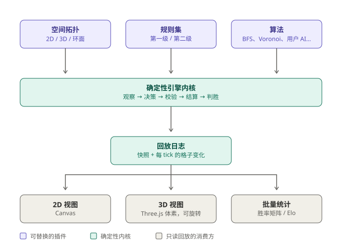

# 01 · 总体架构

## 一句话

把空间、规则、算法、画面拆成四个互不知情的部件，中间夹一个确定性的引擎。这样 2D 换 3D 只是换一个拓扑，第一级换第二级只是换一套规则，算法代码不用改。



## 四个关键决定

### 1. 空间：把世界当成图，不当成网格

引擎只认识格子编号 `0…N-1` 和 `neighbors(cell)`。2D 网格、3D 体素、六边形、首尾相接的环面，都是同一个 `Topology` 接口的不同实现。状态用扁平数组存（`owner[cell]`）。

算法面向"邻居"写，所以同一份算法代码能同时跑在 2D 和 3D 上。只有渲染器需要知道维度。

例外：螺旋、扫描线、Hilbert 曲线这类几何算法要用到坐标，目前只有 2D 版本。算法的元数据里要标明它适用哪些拓扑，界面据此禁用不适用的选项。

### 2. 算法能做什么：前沿加预算

每个 tick，每个算法有固定的占领次数（原型里是 1 次），只能占与自己领地相邻的格子。于是一个算法的本质就是"前沿上先挑哪一格"：

- BFS 挑最早发现的
- DFS 挑最新发现的
- 贪心挑离对手最近的

预算必须固定或缓慢增长。如果允许每 tick 占满整个前沿，结果完全由出生点决定，算法没有任何选择可言。

### 3. 时间：同时出手，确定性结算

所有算法看同一份快照提交动作，引擎统一结算。两方同时抢同一格时，用带种子的随机数裁决。

- 没有先手优势。
- 同一个种子永远复现同一局。这是回放、调试、批量统计的前提。

实现上要守住确定性：自带伪随机数发生器（不用 `Math.random`），规则里只用整数运算，遍历顺序固定。

### 4. 引擎与画面彻底分离

引擎是没有 I/O 的纯逻辑，只输出"每 tick 哪些格子换了主人"。2D 视图、3D 视图、批量统计都只读这份回放。批量对战可以无界面全速跑上千局。

## 核心接口（草案）

```ts
interface Topology {
  size: number                                  // 格子总数
  neighbors(cell: number): readonly number[]
  position(cell: number): [number, number, number]  // 给渲染器和几何算法用
}

interface Agent {
  act(obs: Observation): Action[]               // 每个 tick 调用一次
}

interface RuleSet {
  resolve(world: World, actions: Action[][]): Delta[]   // 校验 + 结算冲突
  result(world: World): Result | null                   // 胜负判定，未结束返回 null
}

type Action = { type: 'claim' | 'attack'; cell: number; power?: number }
```

## 两个级别

规则细节见 [02-rules-and-algorithms.md](02-rules-and-algorithms.md)。这里只说架构上的关系：

- 第一级（圈地）：只能占空格，无格可占时结束，数格子。
- 第二级（攻伐）：把"预算"换成"能量"，第一级就成了第二级的子集。同一个引擎，关掉攻击即可。

第二级没有"填满即结束"的自然终点，边界可以无限拉锯，所以必须设计胜利条件。它要同时保证三件事：一定会结束、能给多方排出名次、拖延无利可图。

## 3D

- 引擎层面 3D 几乎是白送的：换一个 `Topology` 实现，邻居从 4 个变成 6 个。
- 难点在看见内部。需要三种手段配合：只画表面体素；可拖动的切片（切出来就是一张 2D 图，直接复用 2D 渲染器）；按玩家显隐或半透明。
- 用户明确要求：3D 观战必须能转动立方体。正式实现用 Three.js（`InstancedMesh` 画体素，轨道控制器负责旋转缩放）。后端只传体素数据，不传画面。

## 技术栈

以下是我的建议，用户还没有明确确认：

- 全部用 TypeScript。引擎做成零依赖的包，浏览器和 Node 都能跑。
- 2D 用 Canvas，3D 用 Three.js。
- 只有当主要目的变成训练强化学习算法时，才值得改用 Python。

## 路线图

1. 引擎内核 + 2D 网格 + 第一级规则 + 几个基线算法（随机、BFS、贪心）+ Canvas 视图。
2. 回放 + 无界面批量对战 + 胜率矩阵。
3. 3D 拓扑 + 体素视图。引擎和算法应当一行不改，这一步就是对抽象的验收。
4. 第二级规则 + 胜利条件 + 可编程 AI。

后端怎么分模块、怎么部署，见 [03-backend.md](03-backend.md)。
