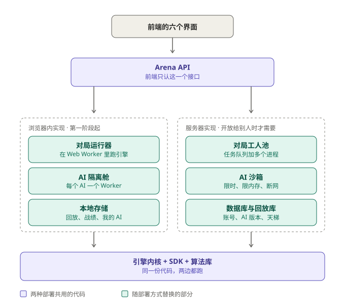

# 03 · 后端架构

这份方案在 2026-11-16 提出，用户尚未回复是否认可。

## 核心决定

后端逻辑写成一套到处都能跑的模块。

- 第一阶段它住在浏览器的 Web Worker 里，不需要服务器，成品是纯静态网站。
- 要开放给别人提交 AI 时，同一套模块搬到服务器上。
- 前端只对着一个接口（`Arena`）编程，不关心对面是本地还是远程。



第一阶段不设服务器的依据：原型里 3,300 局 48 × 48 的对战，连同其他几个场景，单线程 Node 一共 4 秒跑完。

## 模块

| 模块 | 职责 | 服务的界面 |
|---|---|---|
| 引擎内核 | 世界状态、规则、每 tick 结算、胜负判定；纯计算，结果确定 | 全部 |
| SDK 与算法库 | 统一的 `Agent` 接口；每个算法附一份元数据（名称、分类、适用拓扑、参数） | 对局设置、AI 工坊 |
| 对局运行器 | 按配置跑一局：向各方要动作、限时、校验、记录 | 2D、3D、攻伐观战 |
| 回放与分析 | 存每 tick 的格子变化；势力范围等指标从回放现算 | 时间轴、记分板 |
| 批量与评分 | 生成对阵表、并行跑、汇总胜率矩阵、算 Elo | 批量对战 |
| AI 运行时 | 第二阶段：检查并打包用户代码，隔离运行，计时 | AI 工坊 |

建议的包划分（单仓库）：

```
packages/
  engine/       引擎内核，零依赖
  sdk/          Agent 接口、观察与动作的类型、辅助函数（算法作者只依赖这个）
  algorithms/   内置经典算法，每个算法一个模块 + 一份元数据
  replay/       回放格式、编解码、定位到任意 tick；分析器（势力范围等）
  runner/       跑一局；AgentHost 的几种实现
  tournament/   对阵表、任务调度、汇总、评分
  web/          前端
  server/       需要时才有：HTTP + WebSocket、账号、持久化、任务队列
```

## 四个关键约定

### 1. 对局配置是一份 JSON

地图、种子、规则及其参数、各参赛者的算法和版本，全部在配置里。同一份配置重跑，一定得到同一局。

规则参数（大本营防御、能量上限、补给线开关等）都放在配置里，不写死在代码中。原型已经证明这些数值需要反复调。

```ts
interface MatchConfig {                       // 草案
  engineVersion: string
  topology: { kind: 'grid2d' | 'grid3d'; size: number[]; wrap: boolean }
  map: { seed: number; walls: string; bases: string }
  rules: { level: 1 | 2; params: Record<string, number | boolean> }
  players: { agent: string; version: string; params?: Record<string, unknown> }[]
  seed: number
  limits: { maxTicks: number; msPerTick: number }
}
```

### 2. 回放存结果，不存过程

回放记录每 tick 哪些格子换了主人，加上定期的完整快照。拖时间轴时，从最近的快照往后推。

看回放不需要重新模拟。所以 AI 超时这类不确定因素不会让回放走样，引擎升级后旧回放也还能看。

```ts
interface Replay {                            // 草案
  config: MatchConfig
  keyframes: { tick: number; owner: Uint8Array }[]
  deltas: { tick: number; changes: [cell: number, owner: number][] }[]
  events: { tick: number; type: string; data: unknown }[]
  result: { ranking: number[]; reason: string; ticks: number }
}
```

体量很小：40 × 40 × 20 的一份完整快照是 32,000 字节；一局 128 × 72 的第一级对战最多 8,812 次格子变化，估算几十 KB。

势力范围、前线这类指标不存进回放，由观看端从状态现算。

### 3. 算法只通过消息和引擎打交道

引擎发观察，算法回动作，双方不共享内存。经典算法和用户 AI 走同一条通道。

所以同一个算法可以有三种运行方式，引擎都不用改：

| AgentHost 实现 | 用在哪 |
|---|---|
| 进程内直接调用 | 内置的经典算法（可信代码） |
| 独立 Worker，带每 tick 时限 | 第二阶段，用户在本机写的 AI |
| 服务器沙箱 | 开放给别人提交之后 |

观察数据只发变化，不是每个 tick 把整张地图复制一遍，由 SDK 在算法那一侧还原出完整状态。3D 大图上这一点很重要：32,000 格 × 4 方 × 上万 tick，整份复制的开销很大。

### 4. 3D 传数据，不传画面

后端只给体素状态。旋转、缩放、切片、显隐全部在浏览器里完成。

## 前端看到的接口

```ts
interface Arena {                             // 草案
  listAlgorithms(): Promise<AlgorithmMeta[]>
  createMatch(config: MatchConfig): Promise<MatchId>
  watch(id: MatchId, fromTick?: number): AsyncIterable<TickDelta>  // 直播和回放同一条通道
  getReplay(id: MatchId): Promise<Replay>
  runTournament(spec: TournamentSpec): Promise<TournamentId>
  getTournament(id: TournamentId): Promise<TournamentState>         // 进度、胜率矩阵、排行
  // 第二阶段
  checkBot(source: string): Promise<CheckResult>
  testBot(source: string, opponent: AlgorithmId): Promise<MatchId>
  submitBot(source: string): Promise<BotVersion>
}
```

这个接口有两个实现：浏览器内实现（Worker + 浏览器本地存储）和服务器实现（HTTP + WebSocket）。切换只是配置。

## "谁来写 AI"这个问题

第二阶段每个参赛者是一段代码。关键问题是：这些代码只会是用户自己写的，还是别人也能把代码传上来参赛？

- 只有自己写：代码可信，在自己的浏览器里跑就行。
- 别人也能传：陌生人的代码可能写出死循环把对局卡死，可能偷改对手的数据，可能每步算很久占便宜，甚至攻击服务器。所以要把每段代码关进沙箱（只能看到游戏给它的信息，只能交回动作），并限制每步的思考时间。这些得在服务器上做。

这个问题目前没有答案（用户第一次没看懂，重新解释后还没回复）。架构两种情况都兼容，区别只在下面第 4 步做不做。

服务器沙箱有几种做法，等真的要做时再选：

| 做法 | 特点 |
|---|---|
| V8 隔离区 | 快，但要配合进程级的隔离才稳妥 |
| 把一个小型 JS 引擎编译成 WASM 来跑 AI | 慢一些，隔离强，可以按指令数计费而不是按时间，结果更可复现 |
| 每个 AI 一个受限进程或容器 | 最重，但能支持 JS 以外的语言 |

## 落地顺序

1. 引擎、SDK、算法库、浏览器内运行器、回放。纯静态网站，没有服务器。
2. 批量对战用多个 Worker 并行，结果存在浏览器本地。
3. 第二级规则和 AI 工坊，用户代码在独立 Worker 里限时运行。仍然没有服务器，够一个人自己写 AI 用。
4. 只有要开放给别人时才做：服务器、账号、沙箱、天梯。

## 需要留意的风险

- 确定性：规则里避免浮点运算，自带随机数发生器，遍历顺序固定。
- 规则版本：回放头里记录引擎版本和规则参数。回放存的是结果，所以旧回放始终能看。
- 第二级的平衡：原型里出现过"一波流秒杀"和"两方僵持到 tick 上限"。规则参数化加批量对战，就是调平衡的实验台。
