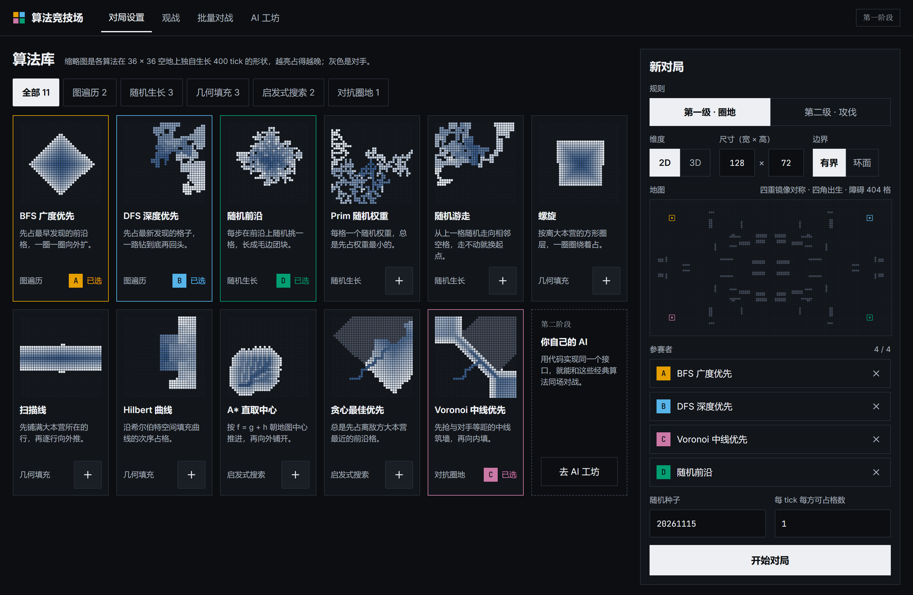
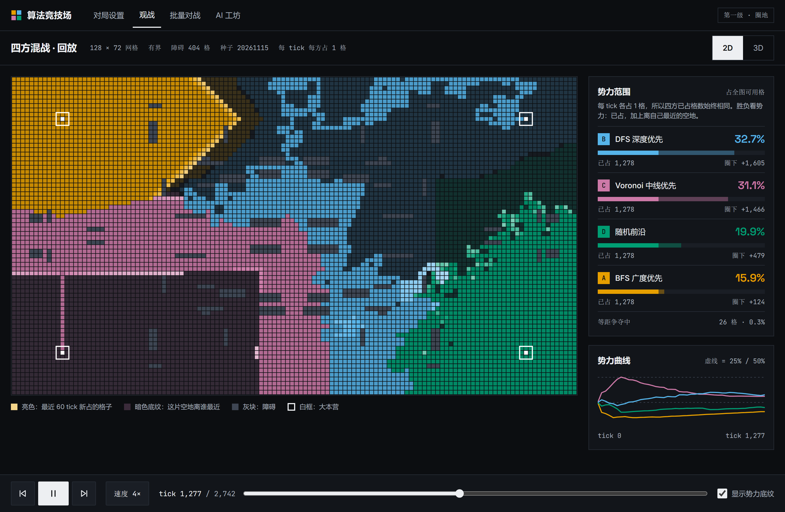
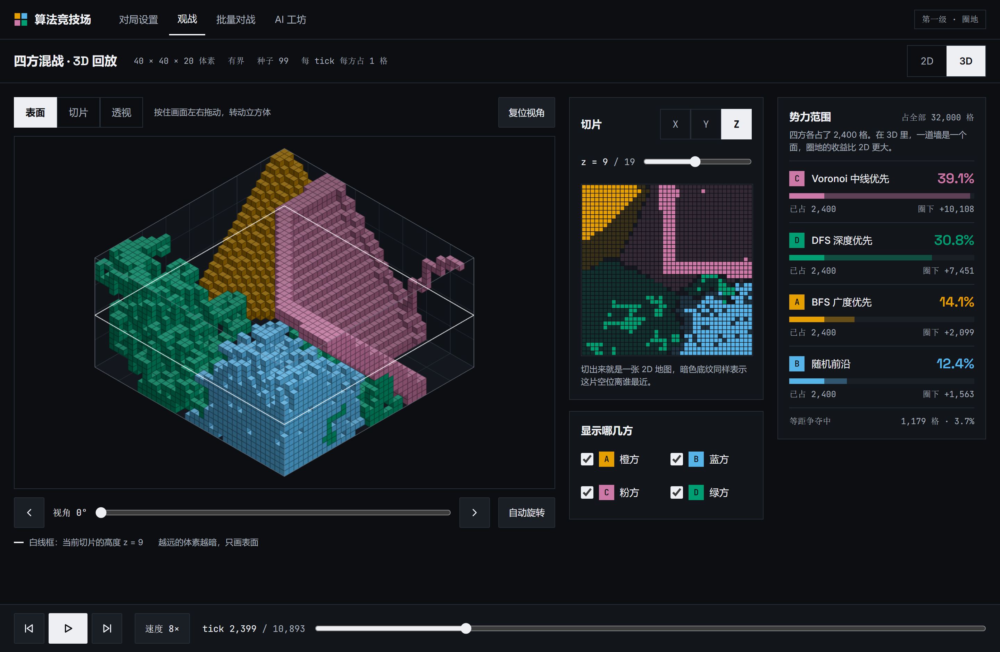
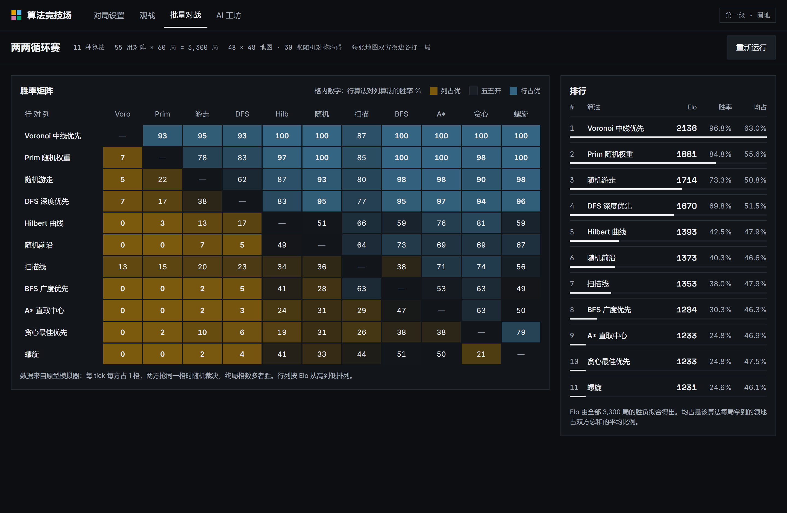
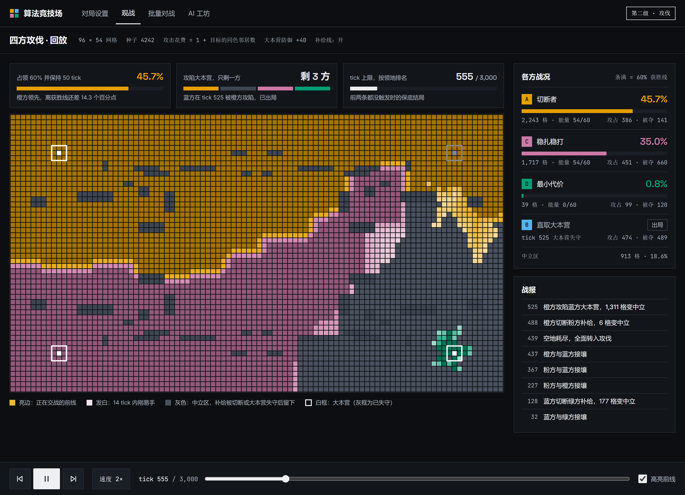
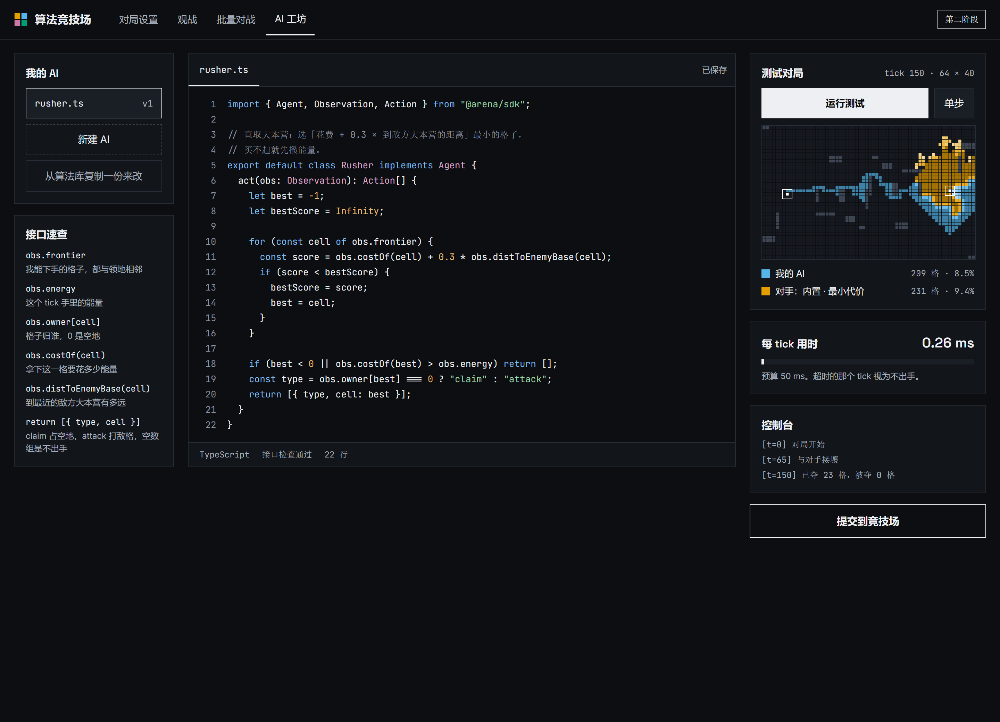

# 04 · 前端设计

用户在 2026-11-16 看过概念图后的评价是"front-end 非常好"，同时提了一条要求：3D 观战必须能转动立方体。

## 在哪里看

| 形式 | 位置 |
|---|---|
| 截图 | `design/screens/` |
| 可本地打开的网页版 | `design/mockups/`，从 `setup.html` 进入，界面之间能跳转，3D 可以转 |
| 线上设计画布 | https://claude.ai/artifact/VyV3fsMxy72tWcajLas5R9 （私有，仅本人可见） |

界面上的地图和数字都来自原型模拟器真实跑出的对局。界面外壳是静态示意：除了导航链接和 3D 旋转，按钮都不起作用。

## 六个界面

### 1. 对局设置与算法库

- 左侧是算法库：11 张卡片，每张有生长形状的缩略图、一句话说明和分类，可以按分类筛选，点加号加入对局。第 12 张卡片是"你自己的 AI"，通向 AI 工坊。
- 右侧是新对局的配置：规则（第一级或第二级）、维度（2D 或 3D）、尺寸、边界（有界或环面）、地图预览、参赛者（最多四方，各有颜色和字母）、随机种子、每 tick 可占格数。
- 需要后端提供：算法元数据列表、地图生成、配置校验。

### 2. 2D 观战

- 地图占主体。亮色是最近 60 tick 新占的格子，暗色底纹表示这片空地离谁最近，白框是大本营。
- 右侧记分板按"势力范围"排名，每一方的条分成已占（实色）和圈下（浅色）两段。下面是势力随时间变化的曲线。
- 底部是播放控制：上一步、播放或暂停、下一步、速度、时间轴。
- 需要后端提供：对局执行、逐 tick 的变化流、回放。势力范围由前端从状态现算。

### 3. 3D 观战

- 中间是体素视图，可以转动。三种查看模式：表面、切片、透视。
- 右侧第一栏是切片：选轴、选层，切出来的一层按 2D 地图显示。下面可以按玩家显隐。
- 最右是和 2D 相同的势力范围记分板。
- 概念图里的旋转是用 24 个预渲染角度（每 15° 一帧）模拟的，只能水平转。正式实现用 Three.js，可以任意角度旋转和缩放。

### 4. 批量对战与排行

- 胜率矩阵：格内数字是行算法对列算法的胜率，蓝色表示行占优，橙色表示列占优。行列按 Elo 排序。
- 右侧排行：Elo、总胜率、平均领地占比。
- 需要后端提供：对阵表生成、并行执行、结果汇总、评分。

### 5. 第二级 · 攻伐观战

- 顶部三张卡片对应三条胜利条件的进度：占领 60%、只剩一方、tick 上限。
- 地图上亮边是正在交战的前线，发白的格子刚刚易手，灰色是中立区，灰框是已失守的大本营。
- 右侧是各方战况（领地、能量、攻占和被夺的格数）和战报（接壤、切断补给、攻陷大本营等事件）。

### 6. AI 工坊

第二阶段的界面：用代码写自己的参赛 AI。

## AI 工坊能做什么

1. 写代码。实现一个 `act(obs)` 函数：每个 tick 引擎把局面交给你，你返回这一步要占或要打的格子。左下的"接口速查"列出可用的信息：能下手的格子、手里的能量、格子归属、拿下一格的花费、到敌方大本营的距离。
2. 从经典算法起步。"从算法库复制一份来改"，不必从空白开始。
3. 试跑。"运行测试"让你的 AI 和一个内置对手打一局，右侧小地图显示战况；"单步"一个 tick 一个 tick 地看。
4. 看耗时。"每 tick 用时"显示你的 AI 每步思考了多久，并与预算对比。超时的那一步视为不出手。概念图里的预算 50 ms 是示意值。
5. 看日志。控制台显示对局事件，以及 AI 自己打印的调试信息。
6. 检查代码。编辑器底栏显示代码是否通过接口检查。
7. 提交。"提交到竞技场"之后，这个 AI 成为一个带版本号的参赛者，出现在对局设置和批量对战里，和经典算法同场比。

概念图里展示的代码是一个真实策略（"直取大本营"），和原型里实际跑的那个示例 AI 逻辑一致；测试对局的地图和数字也来自原型的真实运行。`@arena/sdk` 这个包名是占位。

## 界面之间的跳转

顶部导航四项：对局设置、观战、批量对战、AI 工坊。对局设置里的"开始对局"进入 2D 观战；2D 和 3D 观战之间用右上角的开关切换；算法库里"你自己的 AI"卡片通向 AI 工坊。

## 设计规范

风格：深色底，细线分隔，方正的角。四个参赛者的颜色是画面上仅有的彩色，其余全是中性色。

| 用途 | 色值 |
|---|---|
| 页面底色 | `#0C0E11` |
| 面板 | `#12151A` |
| 控件底 | `#1A1E25` |
| 分隔线 | `#272D36` |
| 主要文字 | `#EDEFF2` |
| 次要文字 | `#A7B0BC` |
| A 方 · 橙 | `#E69F00` |
| B 方 · 蓝 | `#56B4E9` |
| C 方 · 粉 | `#CC79A7` |
| D 方 · 绿 | `#009E73` |

- 四个参赛者的颜色取自 Okabe–Ito 色盲友好配色。每一方另有字母标记（A、B、C、D），不单靠颜色区分。
- 主按钮是浅底深字（`#EDEFF2` 底，`#0C0E11` 字）。
- 字体：正文 Inter，标题和大数字 Space Grotesk，数据和代码 JetBrains Mono。中文回落到系统字体。
- 可点击的控件高度不低于 44px。
- 势力范围的两段条：已占用实色，圈下用同色 38% 不透明度。
